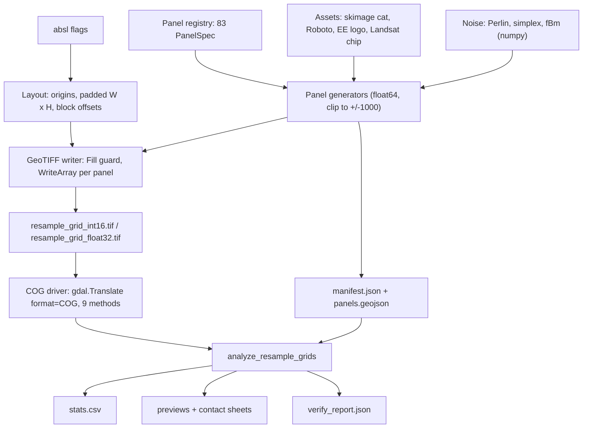

<!-- disableFinding(LINE_OVER_80) -->
# Design and Implementation Plan: Overview Resampling Test Grids

*   **Document Status**: Draft (design only; nothing implemented yet).
    Revised 2026-09-28: Int16 instead of Int32, literal 100 px guards, NaN
    nodata for Float32, GDAL COG driver only.
--------------------------------------------------------------------------------

## Goal Description

Build two small, self-contained Python tools and their tests:

1.  **`make_resample_grids.py`** (P0) writes the **Int16** and **Float32**
    test grids from PRD §5, plus `manifest.json` and `panels.geojson`. With
    `--make_cogs`, it also builds reference COGs for all nine
    `OVERVIEW_RESAMPLING` methods with the **GDAL COG driver**.
2.  **`analyze_resample_grids.py`** (P1) reads those outputs and produces:
    *   `stats.csv`;
    *   previews and contact sheets;
    *   a `--verify` report of the manifest's behavior assertions.

Everything runs against the GDAL (`//third_party/py/osgeo`).
Outputs go to a local disk directory.

--------------------------------------------------------------------------------

## User Review Required

> [!IMPORTANT]
> **Literal 100 px guards (PRD D1, decided).** Panels start at
> x0 = 100 + 1124·c and y0 = 100 + 1124·r. All origins are multiples of 4,
> so panels are block-aligned at 2× and 4× but not at 8×, 16× and 32×.
> The plan handles this in three ways:
> *   the manifest records each panel's offset per level;
> *   expectations are computed in **absolute** grid coordinates;
> *   the analysis reads only overview pixels whose footprint is entirely
>     inside a panel.
>
> W and H are padded to multiples of 32 (6848 × 15840), so every overview
> level is exactly half the previous one.

> [!IMPORTANT]
> **COG driver only (PRD D7, decided).**

> [!IMPORTANT]
> **Nodata: Int16 −9999, Float32 NaN (PRD D5, decided).**
> *   With a nodata tag, every method except NEAREST takes the mask-aware
>     code path, even for panels without nodata. A second run with
>     `--nodata=none` covers the unmasked path.
> *   NaN never equals itself, so every comparison in tests and analysis is
>     NaN-aware (`np.isnan`, `np.array_equal(..., equal_nan=True)`).
> *   Phase 0 confirms that GDAL's nodata mask flags NaN pixels when the tag
>     is NaN.

> [!IMPORTANT]
> **Cascading.** GDAL may build each level from the previous level
> ("cascading") or directly from the base, depending on chunk size and
> tiling (PRD §6.3). Phase 0 records which strategy the full grid gets. The
> integration test forces cascading with `GDAL_OVR_CHUNK_MAX_SIZE`.

> [!NOTE]
> **EE `maxPixels` and brand.** 108.5 Mpx is above EE's default `maxPixels`
> (1e8). The EE logo and "Google" text are for internal use only until brand
> review.

--------------------------------------------------------------------------------

## 1. Architecture Overview



--------------------------------------------------------------------------------

## 2. Package Layout and BUILD

```
example-grid/
├── PRD.md, PLAN.md, TASKS.md, LEDGER.md, README.md
├── BUILD
├── make_resample_grids.py            # generator CLI + library
├── make_resample_grids_test.py       # unit tests (layout, panels, manifest)
├── analyze_resample_grids.py         # analysis CLI + library (P1)
├── analyze_resample_grids_test.py    # unit tests (reference impls, stats)
├── resample_grids_integration_test.py  # --small grid, all methods, both dtypes
└── assets/
    ├── ASSETS.md                     # provenance, license, extraction commands
    ├── ee_logo.png                   # copy of EE-logo.png
    └── landsat_b8_grand_bahama_1024.tif  # 1024² UInt16 chip, ~2 MB
```


Notes:

*   The cat comes from `skimage.data.chelsea()` (CC0, per the docstring in
    [`_fetchers.py` L906–921](third_party/py/skimage/data/_fetchers.py#L906-L921)).
*   Asset paths are found with `resources.GetResourceFilename`. The
    `--font_path`, `--logo_path` and `--satellite_path` flags override them.
*   `opensimplex` exists but is scalar and far too slow for 1 Mpx
    panels, so noise is implemented in vectorized numpy (§6).
*   `matplotlib` is not needed. Previews and contact sheets use PIL.

--------------------------------------------------------------------------------

## 3. Command-Line Interface

### 3.1 `make_resample_grids`

| Flag | Default | Purpose |
| --- | --- | --- |
| `--output_dir` | *(required)* | Output directory. Created if missing.. |
| `--dtypes` | `int16,float32` | Which grids to write. |
| `--panel_px` / `--guard_px` / `--margin_px` | `1024` / `100` / `100` | Layout (§4). |
| `--columns` | `6` | Panels per row. With `12`, two families share a row. |
| `--small` | `False` | Shortcut for `--panel_px=256` with the same 100 px guards and margins, giving a 2240 × 5088 grid for smoke tests (§4). |
| `--seed` | `559677208` | Master seed. |
| `--nodata` | `on` | `on` writes row 13 and the nodata tags; `none` drops row 13 and both tags. |
| `--int16_nodata` | `-9999` | Int16 nodata value. |
| `--float32_nodata` | `nan` | Float32 nodata value (`nan` or a number). |
| `--guard_value` | `0` | Value of guard, margin and empty-slot pixels. |
| `--crs` / `--pixel_size` / `--origin` | `EPSG:3857` / `10` / `0,0` | Georeferencing (top-left corner). |
| `--panels` | *(all)* | Comma-separated panel IDs or row numbers to generate. Other panels are left at `guard_value`. |
| `--make_cogs` | `False` | Build the COG-driver references (§9). |
| `--methods` | all 9 | Subset of methods for `--make_cogs`. |
| `--cog_blocksize` | `512` | COG driver `BLOCKSIZE`. |
| `--overview_count` | `5` | Number of levels (factors 2…2^n). |
| `--jobs` | `4` | COGs built in parallel (processes). |
| `--num_threads` | `4` | GDAL `NUM_THREADS` per job. |
| `--font_path` / `--logo_path` / `--satellite_path` | *(runfiles)* | Asset overrides. |
| `--force` | `False` | Skip the free-disk check (§13). |

Compression is not a flag. Module constants `COMPRESS = "ZSTD"` and
`ZSTD_LEVEL = 22` feed one helper, `tiff_compression_options(driver)`, which
returns `["COMPRESS=ZSTD", "ZSTD_LEVEL=22"]` for GTiff and
`["COMPRESS=ZSTD", "LEVEL=22"]` for COG. Every TIFF write goes through it
(PRD D9).

### 3.2 `analyze_resample_grids` (P1)

| Flag | Default | Purpose |
| --- | --- | --- |
| `--input_dir` | *(required)* | Directory written by `make_resample_grids`. |
| `--stats` / `--previews` / `--contact_sheets` / `--verify` | `True` / `True` / `True` / `False` | Which outputs to write. |
| `--rounding` | `auto` | Int16 rounding used by the reference implementations: `half_away`, `half_even`, `trunc`, or `auto` (read the measured rule from `calib_rounding_int`). |
| `--panels` / `--methods` / `--dtypes` | *(all)* | Subsets. |

--------------------------------------------------------------------------------

## 4. Layout Engine

A frozen dataclass `Layout(panel_px, guard_px, margin_px, columns, rows,
overview_count)`:

*   `pitch = panel_px + guard_px`
*   `raw_width = 2·margin + columns·panel + (columns − 1)·guard`. `width` is
    `raw_width` rounded up to a multiple of `align = 2^overview_count` (32)
    by widening the right margin. The height is computed the same way
    (bottom margin).
*   `panel_origin(r, c) = (margin + c·pitch, margin + r·pitch)`
*   `block_offset(r, c, L) = (x0 mod 2^L, y0 mod 2^L)`, recorded in the
    manifest for L = 1…`overview_count`.
*   `inner_window(r, c, L)`: the overview pixels whose 2^L footprint lies
    entirely inside the panel, i.e. columns `ceil(x0 / 2^L)` up to (not
    including) `floor((x0 + panel_px) / 2^L)`, and the same for rows. At
    most one row and one column are lost on each side.
*   `overview_shape(L) = (width >> L, height >> L)`. Because W and H are
    multiples of 2^overview_count, `W / 2^L` is exact at every level.
    `validate()` asserts this.

| Configuration | W × H (raw → padded) | Levels 1…5 |
| --- | --- | --- |
| Default | 6844 × 15836 → **6848 × 15840** | 3424×7920, 1712×3960, 856×1980, 428×990, 214×495 |
| `--nodata=none` (13 rows) | 6844 × 14712 → 6848 × 14720 | …, 214×460 |
| `--columns=12` (7 rows) | 13588 × 7968 → 13600 × 7968 | …, 425×249 |
| `--small` (256 px panels) | 2236 × 5084 → 2240 × 5088 | 1120×2544 … 70×159 |

Panel block offsets (default layout): all origins are ≡ 0 (mod 4), since
100 ≡ 1124 ≡ 0 (mod 4). Mod 32, the x offsets are 4, 8, 12, 16, 20, 24 for
columns 0–5, and the y offsets are `(4 + 4r) mod 32` for rows 0–13. `--small`
keeps the 100 px guard, so its origins (100 + 356·k) are also ≡ 0 (mod 4).

Rows are assigned by family (PRD §5.4). The catalog lists `(row, col)` for
each panel ID. With `--columns=12`, rows 2k and 2k+1 are packed side by side.

--------------------------------------------------------------------------------

## 5. Panel Registry and Generators

### 5.1 Registry

```python
@dataclasses.dataclass(frozen=True)
class PanelSpec:
  panel_id: str            # e.g. "sparse_posts_square"
  row: int
  col: int
  family: str              # "calibration", "categorical", ...
  generator: Callable[[PanelContext], PanelResult]
  designed_integer: bool   # values are integers by construction
  uses_nodata: bool        # only row 13


@dataclasses.dataclass(frozen=True)
class PanelContext:
  size: int                # panel_px
  origin: tuple[int, int]  # absolute (x0, y0), for absolute-phase expectations
  rng: np.random.Generator # PCG64(SeedSequence([seed, crc32(panel_id)]))
  assets: Assets           # lazily loaded font, cat, logo, satellite chip


@dataclasses.dataclass
class PanelResult:
  values: np.ndarray       # float64, (size, size)
  nodata_mask: np.ndarray | None
  params: dict[str, Any]
  subregions: list[Subregion]      # id, x, y, w, h (panel-relative), params
  expectations: list[Expectation]  # §10.2
```

*   A decorator `@register_panel(panel_id, row, col, family, ...)` adds each
    generator to the `PANELS` dict. Tests check that there are 83 unique IDs
    and unique `(row, col)` slots, with at most `columns` panels per row.
*   Panel content never depends on `origin`. Only the expectations do, so a
    panel's pixels are the same wherever it is placed.
*   Post-processing is shared by all panels:
    1.  `np.clip(values, -1000, 1000)`.
    2.  Int16 grid: `(np.sign(v) * np.floor(np.abs(v) + 0.5)).astype(np.int16)`,
        i.e. round half away from zero.
    3.  Float32 grid: `v.astype(np.float32)`.
    4.  Apply `nodata_mask` last: `−9999` in Int16, `NaN` in Float32.
*   Designed-integer panels assert `np.all(values == np.round(values))`, so
    Int16 and Float32 are identical there (outside nodata).
*   Geometry is expressed on the panel's 8 × 8 lattice
    (`cell = size // 8`, 128 px at full size). Features with an absolute size
    (1 px lines, 1–64 px posts) keep their pixel size. Only the number of
    repetitions scales with `--small`. Features that do not fit a cell are
    skipped and not recorded in the manifest.
*   Expectations that depend on phase are computed from absolute
    coordinates. Example: a NEAREST impulse at absolute (x, y) survives at
    level L iff `x % 2^L == 0 and y % 2^L == 0`. With every origin ≡ 0
    (mod 4) and local offsets 0…7, `calib_impulse_pos` keeps 16 / 4 / 1
    impulses at 2× / 4× / 8× in every panel position. The counts at 16× and
    32× depend on the panel's offset and are computed per panel.

### 5.2 Algorithms by Row

| Row | Technique |
| --- | --- |
| 0 Calibration | Constant quadrants; full +1000 panel; rounding motifs `[[k,k],[k+1,k+1]]` (mean k+0.5), `[[k,k],[k,k+1]]` (k+0.25), `[[k,k+1],[k+1,k+1]]` (k+0.75), and 4 × 4 motifs with 2 × 2 means that round differently from the 4 × 4 mean; MODE tie motifs; impulses at local `(128a + i, 128b + j)`, i, j ∈ 0…7. Motifs repeat with period 2 or 4, and origins are ≡ 0 (mod 4), so they stay block-aligned at 2× and 4×. |
| 1 Categorical | Voronoi: random seeds + `scipy.spatial.cKDTree.query` over pixel centers, class = label[nearest]. Land cover: `scipy.ndimage.gaussian_filter` of white noise, quantized by quantiles into 15 NLCD codes. Thin features: `PIL.ImageDraw.line` (straight and sine polylines) with widths 1–5. Dither: `rng.random() < p`. Edge phase: boundaries at `x0 + p`. |
| 2 Lines | Index masks: `(y % s) == 0`. Bresenham for angled lines: `PIL.ImageDraw.line` width 1, no anti-aliasing. Diagonal grids: `((x + y) % s == 0) | ((x − y) % s == 0)`. |
| 3 Checkers / stripes | `((x // c + y // c) % 2) * 2 − 1` scaled; stripes `((x // (P/2)) % 2)`, with odd periods using `floor(2x / P) % 2`; duty cycle `(x % P) < on`. |
| 4 Frequency | Zone plate `1000·cos(π r² / (2·512))` for r ≤ 512 (local frequency r/1024 cycles/px reaches 0.5 at r = 512), else 0. Linear chirp with phase `2π ∫ f`, where f goes from 1/64 to 1/2. Siemens star `1000·sign(sin(36θ))`. Sine gratings `1000·sin(2π (x cosφ + y sinφ) / P)`. USAF: three bars per element, widths 1…16 px. |
| 5 Posts / holes | Squares and disks (`(x − cx)² + (y − cy)² ≤ r²`, sampled at pixel centers) at the listed sizes × offsets 0…7 on the lattice; dipoles; features on a ramp. |
| 6 Steps | Half-planes, square + quadrant checker, phase strips, bars, small steps h ∈ {1, 2, 3, 5, 10, 50, 200}. |
| 7 Diagonal steps | Half-plane `x·sinθ − y·cosθ > c`, sampled at pixel centers (aliased). The anti-aliased version uses 8 × 8 supersampled area coverage. Diamond: `|x − cx| + |y − cy| ≤ R`. |
| 8 Terrain | Gaussian peaks and pits; ridges and valleys as Gaussian profiles of the signed distance to a line; saddle `k(x² − y²)`; monkey saddle `k(x³ − 3xy²)`; MATLAB `peaks` on [−3, 3]², scaled to 1000 / max\|z\|. |
| 9 Terraces | `100·floor(z / 100)` of a cone, `peaks`, an Archimedean spiral (`r − aθ`), and sinuous fields; fine terraces with 2–4 px periods; soft risers `100·(k + 0.5 + 0.5·tanh((z − z_k) / w))`. |
| 10 Slopes | Linear ramps; gentle ramps at 0.1 and 0.37 units/px through 0; sawtooth `(x mod P) / P`; cone and bowl `±(1000 − 2000·r / R)`. |
| 11 Noise | `rng.uniform`, `rng.normal`, quadrant biases; Perlin, simplex and fBm (§6); salt-and-pepper `rng.random() < density`. |
| 12 Imagery / text | §7. |
| 13 Nodata | The base field (ramp, smooth noise, ±steps, terrain, Voronoi classes) plus a boolean mask: square holes at offsets, a random mask at fractions, 1 px lines and checker, strips, and a coastline where terrain ≤ 0 is set to nodata. |

--------------------------------------------------------------------------------

## 6. Noise Generators (vectorized numpy)

*   **Perlin (gradient noise).**
    1.  Draw unit gradient vectors on an `(n + 2)²` lattice from `ctx.rng`.
    2.  For every pixel, compute the cell index and fractional position.
    3.  Blend the four corner dot products with the fade curve
        `6t⁵ − 15t⁴ + 10t³`.
    4.  Normalize by the 99.9th percentile of |x| and scale to ±1000.
*   **Simplex (2D).**
    1.  Skew with `F2 = (√3 − 1) / 2` and unskew with `G2 = (3 − √3) / 6`.
    2.  Pick the simplex from the sign of `x0 − y0`.
    3.  Sum three corner contributions `max(0, 0.5 − d²)⁴ · (g · d)`, with
        gradients from a 512-entry permutation table shuffled by `ctx.rng`.
    4.  Normalize the same way as Perlin.
*   **fBm.** Six octaves, lacunarity 2, gain 0.5, normalized the same way.
*   Feature scales: 8, 32 and 128 px, one per quadrant, plus fBm in the fourth
    quadrant.
*   Unit tests check determinism, the output range, a roughly zero mean, and
    that the dominant spatial frequency is close to 1/scale (radially
    averaged FFT peak).

--------------------------------------------------------------------------------

## 7. Assets

| Panel | Source | Handling |
| --- | --- | --- |
| `img_cat` | `skimage.data.chelsea()` (451 × 300 RGB, CC0) | PIL `convert("L")`, then `Image.resize(..., LANCZOS)` to 1024 × 681, centered vertically on 0. `v = L / 255 · 2000 − 1000`. |
| `img_text_google_*` | `//third_party/roboto:unhinted/Roboto-Bold.ttf` (Apache-2.0) | For each cap height, find the font size by measuring `font.getbbox("G")`. Binary: draw at 1× and threshold. Anti-aliased: draw at 4× and downsample by box averaging. |
| `img_ee_logo` | `assets/ee_logo.png`, copied from [`EE-logo.png`](EE-logo.png) (1000 × 1000 RGBA) | Luminance `0.299R + 0.587G + 0.114B`, composited over 0 with alpha: `v = α · (L / 255 · 2000 − 1000)`. Placed 1:1 (no resampling) with a 12 px border. |
| `img_landsat` | `assets/landsat_b8_grand_bahama_1024.tif`, extracted from [`LC08_L1TP_014042_20201111_20201119_02_RT_B8.TIF`](testdata/c2/oli_tirs_rt/LC08_L1TP_014042_20201111_20201119_02_RT_B8.TIF) | Stretch the 2nd–98th percentiles of valid (non-zero) DNs to ±1000 and clip. |

Landsat chip extraction:

*   The scene is 15101 × 15401 px, UTM 17N, 15 m, spanning about
    77.7–80.0° W and 24.9–27.0° N (checked with `gdalinfo`).
*   Freeport, Grand Bahama (26.53° N, 78.70° W) is at about pixel 8392,
    line 3678.
*   Candidate window: `-srcwin 7880 3166 1024 1024`. Adjust in Phase 5 after a
    quick-look preview to get a good mix of land, water and coastline, with
    no fill pixels.

```shell
gdal_translate -srcwin 7880 3166 1024 1024 \
  -co COMPRESS=ZSTD -co ZSTD_LEVEL=22 -co PREDICTOR=2 \
  testdata/c2/oli_tirs_rt/LC08_L1TP_014042_20201111_20201119_02_RT_B8.TIF \
  assets/landsat_b8_grand_bahama_1024.tif
```

`assets/ASSETS.md` records, for each asset: the source path and CL, the
license, the exact command, and the SHA-256.

--------------------------------------------------------------------------------

## 8. Base Grid Writer

```python
drv = gdal.GetDriverByName("GTiff")
ds = drv.Create(path, W, H, 1, gdal.GDT_Int16 | gdal.GDT_Float32, options=[
    "TILED=YES", "BLOCKXSIZE=512", "BLOCKYSIZE=512",
    *tiff_compression_options("GTiff"),   # COMPRESS=ZSTD, ZSTD_LEVEL=22
    "PREDICTOR=2" (Int16) | "PREDICTOR=3" (Float32), "BIGTIFF=IF_SAFER",
    f"NUM_THREADS={num_threads}"])
ds.SetGeoTransform([ox, px, 0, oy, 0, -px]); ds.SetSpatialRef(srs)
band.SetNoDataValue(-9999 | float("nan"))   # unless --nodata=none
band.Fill(guard_value)
for spec in PANELS: band.WriteArray(panel_array, x0, y0)
ds.SetMetadata({"RESAMPLE_GRID_SEED": ..., "RESAMPLE_GRID_VERSION": ...,
                "RESAMPLE_GRID_LAYOUT": json, "GDAL_VERSION": gdal.__version__})
```

*   Panels are generated once, as float64. Both data types are written from
    the same array, so they never drift apart.
*   Peak memory is about 1 panel × (8 + 2 + 4) bytes per pixel, roughly 15 MB.
*   Checksums: after closing, read each band back in 512-row strips and
    compute the SHA-256 of the native-endian raw bytes (NaN-safe, since it
    hashes bytes). Record it in the manifest for the determinism check.
*   The writer never builds overviews in the base grids.

--------------------------------------------------------------------------------

## 9. COG Driver References

For each (dtype, method), run in parallel with
`concurrent.futures.ProcessPoolExecutor(--jobs)`:

```python
gdal.Translate(out, base, format="COG", creationOptions=[
    f"OVERVIEW_RESAMPLING={method}", f"OVERVIEW_COUNT={overview_count}",
    "OVERVIEWS=IGNORE_EXISTING", f"BLOCKSIZE={cog_blocksize}",
    *tiff_compression_options("COG"),     # COMPRESS=ZSTD, LEVEL=22
    "PREDICTOR=YES", "BIGTIFF=IF_SAFER",
    f"NUM_THREADS={num_threads}"])
```

*   Output: `cog/<dtype>/resample_grid_<dtype>_<method>.tif`, 18 files in
    total.
*   The COG driver maps `LEVEL` to GTiff `ZSTD_LEVEL`
    ([`cogdriver.cpp` L1235–1239](/gtiff/cogdriver.cpp#L1235-L1239)),
    and the copied overview IFDs inherit the main image's level
    ([`gtiffdataset_write.cpp` L2510–2514](gtiffdataset_write.cpp#L2510-L2514)),
    so every IFD in the COG is written at level 22.
*   The driver's temporary overview file (`*.ovr.tmp`) uses ZSTD at the
    default level; only the debug config option `COG_TMP_COMPRESSION`
    changes it
    ([`cogdriver.cpp` L1113–1116](gtiff/cogdriver.cpp#L1113-L1116)).
    It is lossless and deleted after the build, so it does not affect the
    output.
*   `GAUSS` is not in the COG driver's documented list. Phase 0 checks that
    the driver passes it through to the overview code
    ([`overview.cpp` L4611–4616](gcore/overview.cpp#L4611-L4616)).
    If it does not, the gap is documented and GAUSS is skipped.
*   `check_overviews(path)` checks, for each output:
    *   the overview count, and the §4 sizes at each level;
    *   the block size of the full-resolution image and each overview;
    *   the data type and nodata value (NaN-aware);
    *   `LAYOUT=COG` and `COMPRESSION=ZSTD` in the `IMAGE_STRUCTURE`
        metadata. The ZSTD level is not stored in the file, so a unit test
        on `tiff_compression_options` covers level 22 instead.
*   `//third_party/gdal:validate_cloud_optimized_geotiff*` is not visible to
    `//experimental`, so the full validator runs as a workstation step (§14).

--------------------------------------------------------------------------------

## 10. Manifest and GeoJSON

### 10.1 `manifest.json`

```json
{
  "schema_version": 1,
  "generator": {"name": "make_resample_grids", "version": "0.1.0",
                "argv": ["..."], "seed": 559677208,
                "gdal_version": "3.12.0beta1", "numpy_version": "..."},
  "grid": {"width": 6848, "height": 15840, "raw_width": 6844,
           "raw_height": 15836, "panel_px": 1024, "guard_px": 100,
           "margin_px": 100, "columns": 6, "rows": 14,
           "crs": "EPSG:3857", "geotransform": [0, 10, 0, 0, 0, -10],
           "nodata": {"int16": -9999, "float32": "nan"},
           "guard_value": 0, "overview_factors": [2, 4, 8, 16, 32]},
  "methods": {"NEAREST": "NEAREST", "CUBIC_SPLINE": "CUBICSPLINE", "...": "...",
              "ee_default": {"int16": "NEAREST", "float32": "CUBIC"}},
  "files": {"int16": {"path": "resample_grid_int16.tif", "sha256": "..."},
            "float32": {"...": "..."},
            "cogs": [{"path": "cog/int16/resample_grid_int16_RMS.tif",
                      "dtype": "int16", "method": "RMS"}]},
  "panels": [{
    "id": "calib_constants", "row": 0, "col": 0, "family": "calibration",
    "x": 100, "y": 100, "width": 1024, "height": 1024,
    "block_offset": {"1": [0, 0], "2": [0, 0], "3": [4, 4], "4": [4, 4], "5": [4, 4]},
    "inner_window": {"3": [13, 13, 128, 128], "...": "..."},
    "designed_integer": true, "uses_nodata": false,
    "params": {"values": [1000, -1000, 333, -777]},
    "input_stats": {"min": -1000, "max": 1000, "distinct": 4},
    "subregions": [{"id": "q_neg777", "x": 512, "y": 512, "w": 512, "h": 512}],
    "expectations": [{"id": "rms_sign_loss", "methods": ["RMS"],
                      "levels": [1, 2, 3, 4, 5], "subregion": "q_neg777",
                      "check": "interior_equals", "value": 777,
                      "tolerance": 0, "basis": "source"}]
  }]
}
```

`inner_window` holds `[x_off, y_off, x_size, y_size]` in overview pixels.
For example, at 8× with x0 = 100: columns ceil(100 / 8) = 13 up to
floor(1124 / 8) = 140, i.e. 127 columns. JSON has no NaN, so the Float32
nodata is written as the string `"nan"`.

### 10.2 Expectation Vocabulary

The checks are evaluated by `--verify`. Here, "interior" means the
subregion shrunk by the method's cascaded reach 2r(2^L − 1) at level L, and
restricted to `inner_window`.

| Check | Meaning |
| --- | --- |
| `interior_equals` | Every interior pixel equals `value` ± `tolerance`. |
| `interior_range` | All interior pixels are within [lo, hi]. |
| `exceeds` | max > hi or min < lo somewhere, e.g. CUBIC overshoot. |
| `values_subset_of_input` | No new values (NEAREST and MODE). |
| `nonnegative` | min ≥ 0 (RMS). |
| `equals_reference` | Bit-exact (NaN-aware) match with a numpy reference (`nearest`, `average`, `rms`, `mode`; `direct` or `cascaded`) computed from absolute coordinates. |
| `nodata_fraction` | Fraction of nodata pixels (−9999 or NaN) within [lo, hi]. |
| `count_equals` | For example, NEAREST impulse survivors, computed per panel from its absolute offsets. |

`basis: "source"` checks must pass. `basis: "expected"` results are recorded
but never fail the run.

### 10.3 `panels.geojson`

*   A FeatureCollection with one Feature per panel and per subregion.
*   Coordinates: corners transformed to EPSG:4326 with
    `osr.CoordinateTransformation`, using `OAMS_TRADITIONAL_GIS_ORDER` so
    that points are lon, lat.
*   Rings are counter-clockwise (RFC 7946).
*   Properties: `id`, `kind` (`panel` or `subregion`), `row`, `col`, `family`,
    `label` and `block_offset_32` (the panel's offset mod 32).

--------------------------------------------------------------------------------

## 11. Analysis (P1)

*   **Reading.** For each COG, level L and panel, read only the panel's
    `inner_window` with `band.GetOverview(L − 1).ReadAsArray(...)`.
*   **Nodata.** Int16: `== -9999`. Float32: `np.isnan`. Nodata pixels are
    excluded from statistics and counted separately.
*   **`stats.csv`** columns: `dtype, method, level, panel_id, subregion_id,
    min, max, mean, std, valid_count, nodata_count, count_gt_1000,
    count_lt_minus_1000, distinct_count` (capped at 4096).
*   **Colormap.** Grayscale on [−1000, 1000]; red ramp above +1000; blue ramp
    below −1000; magenta for nodata.
*   **Previews.** One PNG per COG and level ≥ 2, i.e. at most 1712 × 3960.
*   **Contact sheets.** One PNG per panel and dtype, with a grid of methods
    (rows) × levels (columns). Each tile is upscaled with NEAREST to
    256 × 256 so blocks stay visible. Methods, levels and the panel's block
    offset are labeled with Roboto.
*   **Numpy references**, computed from the base grid in absolute
    coordinates:
    *   `nearest(a, L) = a[::2^L, ::2^L]`.
    *   `average`, `rms`: direct (one 2^L × 2^L block reduction) or cascaded
        (2 × 2 reductions, with Int16 rounding after every level, since each
        stored level is Int16).
    *   `mode`: the tie rule from PRD §6.2.
    *   Nodata-aware versions skip −9999 or NaN.
    *   `--rounding=auto` reads the measured rule from `calib_rounding_int`.
*   **`--verify`** writes `verify_report.json` and exits with status 1 if any
    `source` check fails.

--------------------------------------------------------------------------------

## 12. Testing Strategy

| Test | Scope |
| --- | --- |
| `make_resample_grids_test` (small) | Layout math for every row of the §4 table, including block offsets and `inner_window`; registry integrity (83 IDs, unique slots, PRD §5.5 traceability); for each panel, parameterized at `panel_px=256`: shape, finite values outside the nodata mask, ±1000, determinism, independence from the other panels' seeds, integer values for designed-integer panels, nodata only in row 13; Int16 rounding and NaN application; noise properties; the EE→GDAL method mapping; manifest schema (including `"nan"`) and GeoJSON ring orientation. |
| `analyze_resample_grids_test` (small) | Reference implementations on hand-built arrays (rounding motifs, MODE ties, −9999 and NaN blocks); stats with NaN; colormap; expectation evaluator. |
| `resample_grids_integration_test` (large) | `--small` grids (2240 × 5088) in `self.create_tempdir()`, with `GDAL_OVR_CHUNK_MAX_SIZE` set to force cascading; all 9 methods for both dtypes; `check_overviews` on every file; `--verify` source checks pass; NEAREST and AVERAGE `equals_reference` pass; NaN is preserved by NEAREST and masked by the other methods. |

Test data is generated at run time. Nothing large is checked in.

--------------------------------------------------------------------------------

## 13. Disk & Time Budget

Basis: 108.5 Mpx per grid. Int16 is **0.217 GB** raw and Float32 **0.434
GB**. Five overview levels add 1/4 + 1/16 + … ≈ 0.333, so each COG is about
0.289 GB (Int16) or 0.578 GB (Float32) raw.

| Item | Count | Raw (uncompressed, worst case) | Expected with ZSTD level 22 (estimate, measure in Phase 0) |
| --- | --- | --- | --- |
| Base grids | 2 | 0.65 GB | 0.15–0.35 GB |
| Int16 COGs | 9 | 2.6 GB | 0.6–1.5 GB |
| Float32 COGs | 9 | 5.2 GB | 1.5–3.5 GB |
| Previews + contact sheets + CSV/JSON | ~200 files | ~0.3 GB | ~0.3 GB |
| **Total** | | **≈ 8.8 GB** | **≈ 2.5–5.5 GB** |

*   The workstation has about 45 GB free. Before writing, the script
    estimates the total for the selected dtypes and methods from the raw
    column above, and refuses to start if free space is below 1.2× that
    estimate (override with `--force`).
*   Compression varies a lot by panel: constants and lines compress very
    well; noise and imagery barely compress. Level 22 typically saves only
    a few percent over the default level 9, at a much higher write cost.
*   Time targets (PRD §8), to be measured in Phase 0. ZSTD level 22 is the
    slowest level and dominates write time; the estimates assume a few MB/s
    of raw input per compression thread:
    *   Panel generation: under 2 min. Voronoi and the noise panels dominate.
    *   Writing both base grids with ZSTD level 22: about 1–3 min.
    *   Each COG: about 0.5–2 min with `NUM_THREADS=4` (estimate). At
        `--jobs=4`, 18 files take about 5–15 min.
    *   Analysis: under 10 min.
*   Memory: each compressing thread holds its own level-22 ZSTD context
    (large window and match tables, possibly hundreds of MB, PRD §9), and
    `--jobs=4` × `NUM_THREADS=4` gives up to 16 contexts at once. Phase 0
    records peak RSS; lower `--jobs` if needed.
*   A `--small` run (grids plus 18 COGs) takes under a minute and uses less
    than 0.2 GB of disk.

--------------------------------------------------------------------------------

## 14. Verification Plan

Manual checks:

*   Open a contact sheet for each family.
*   In QGIS, load a COG and `panels.geojson` and check that the labels line
    up with the panels at every zoom level.
*   Check that NaN pixels show as nodata in QGIS.

--------------------------------------------------------------------------------

## 15. Risks & Open Items

| Risk / item | Plan |
| --- | --- |
| Panels are offset inside the 8×–32× blocks (100 px guard) | Absolute-coordinate expectations, `inner_window`, and the offsets recorded in the manifest and GeoJSON (§4, §10). |
| `importlib` with digit-leading, hyphenated package path fails | Phase 0 spike. Fallback: `importlib.util.spec_from_file_location` on the runfiles path. |
| skimage `data.chelsea()` fetches over the network | Phase 0. Fallback: read `chelsea.png` from runfiles. |
| GAUSS not accepted by the COG driver | Phase 0. Fallback: skip GAUSS and document it. |
| GDAL does not mask NaN when the nodata tag is NaN | Phase 0. If it does not, record the actual behavior in PRD §6.3; `--float32_nodata=-9999` is the fallback. |
| Small grids use a different overview strategy than the full grid | `GDAL_OVR_CHUNK_MAX_SIZE` in tests; Phase 0 logs the strategy for the full grid. |
| Int16 rounding rule unknown | Measured by `calib_rounding_int`; the references use `--rounding=auto`. |
| Disk pressure (96 % full) | §13 check; `--methods` / `--dtypes` subsets; ZSTD level 22 on every TIFF. |
| ZSTD level 22 write time and memory | Phase 0 measures time and peak RSS per job (§13); lower `--jobs` / `--num_threads` if needed. The level stays at 22 (PRD D9). |
