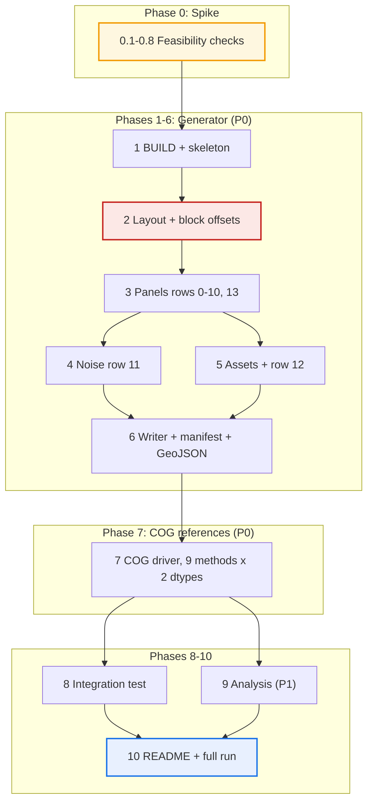

<!-- disableFinding(LINE_OVER_80) -->
# Tasks: Overview Resampling Test Grids

*   **Document Status:** Implemented 2026-09-28 (Phases 0-10; no CL created). Measured: full --make_cogs 21:26 wall, 6.2 GB RSS, 710 MB output; COG fan-out uses ThreadPoolExecutor (spawn/fork unusable) - see LEDGER.
    Revised 2026-09-28: Int16, literal 100 px guards, NaN nodata for Float32,
    GDAL COG driver only.
*   **Design Artifacts:**
    *   [Product Requirements (`PRD.md`)](PRD.md)
    *   [Implementation Plan (`PLAN.md`)](PLAN.md)
    *   [Ledger (`LEDGER.md`)](LEDGER.md):
        all entries for this project go here.
*   **Gate:** D1, D5, D6 and D7 are decided. D2, D3, D4 and D8 in PRD §10.1
    are confirmed before Phase 1 starts.

--------------------------------------------------------------------------------

## Progress Overview

| Phase | Description | Priority | PRD requirements | Status |
| :--- | :--- | :--- | :--- | :--- |
| **0** | Feasibility spike | P0 | Risks §9 | ✅ Done |
| **1** | BUILD, skeleton, flags | P0 | P0-1, P0-7 | ✅ Done |
| **2** | Layout engine and block offsets | P0 | P0-2 | ✅ Done |
| **3** | Panel generators: rows 0–10 and 13 | P0 | P0-3, P0-4 | ✅ Done |
| **4** | Noise generators: row 11 | P0 | P0-3 | ✅ Done |
| **5** | Assets and row 12 | P0 | P0-3, P0-8 | ✅ Done |
| **6** | GeoTIFF writer, manifest, GeoJSON | P0 | P0-4, P0-5 | ✅ Done |
| **7** | COG-driver references | P0 | P0-6 | ✅ Done |
| **8** | Integration test | P0 | P0-7 | ✅ Done |
| **9** | Analysis tool | P1 | P1-1 … P1-5 | ✅ Done |
| **10** | README and full-size run | P0 | P0-8, §8 metrics | ✅ Done |

--------------------------------------------------------------------------------

## Detailed Task Breakdown

### Phase 0: Feasibility Spike

Throwaway code goes in
scratch/`
or in a local sandbox. Record the findings in PLAN §15 and in `LEDGER.md`.

-   [x] **0.1 importlib with this package path.** Create a one-line library
    and test, then check that
    `importlib.import_module("01-resample-options.example-grid.<mod>")`
    resolves. Run it with `$B test $PKG:spike_test`. If it fails, switch to
    `importlib.util.spec_from_file_location`.
-   [x] **0.2 GAUSS through the COG driver.** Run
    `gdal.Translate(..., format="COG", creationOptions=["OVERVIEW_RESAMPLING=GAUSS"])`
    on a 1024² Int16 array and confirm that overviews exist and
    differ from NEAREST.
-   [x] **0.3 NaN nodata.** On a Float32 array with a NaN nodata tag and some
    NaN pixels, build COGs with AVERAGE and CUBIC. Confirm that:
    *   NaN pixels are masked (valid neighbors are not NaN);
    *   all-NaN blocks come out as NaN;
    *   NEAREST copies NaN.

    Repeat without the tag to document how NaN spreads.
-   [x] **0.4 Overview strategy.** 
    -   Confirm that `GDAL_OVR_CHUNK_MAX_SIZE` (minimum 100) forces
        cascaded overview generation on a small grid. Compare AVERAGE
        against the numpy direct and cascaded references on 4 × 4 motifs
        where they differ.
    -   Record which strategy the full 6848 × 15840 grid gets, for Int16 and
        for Float32.
-   [x] **0.5 skimage cat.** Check that `skimage.data.chelsea()` loads
    without network access. Otherwise use the
    runfiles PNG fallback.
-   [x] **0.6 Roboto via resources.**
    `resources.GetResourceFilename("third_party/roboto/unhinted/Roboto-Bold.ttf")`
    with `data = ["//third_party/roboto:unhinted/Roboto-Bold.ttf"]`, then
    `PIL.ImageFont.truetype`.
-   [x] **0.7 Int16 rounding.** Build Int16 overviews for a 4 × 4 motif grid
    with block means of k + 0.5 and k ± 0.25. Record GDAL's Float32 → Int16
    rule (half away from zero, half to even, or truncation).
-   [x] **0.8 Timing, size and memory.** Write one Int16 and one Float32
    full-size base grid and COG with ZSTD level 22 (`ZSTD_LEVEL=22` /
    `LEVEL=22`) and `NUM_THREADS=4`. Record wall time, file sizes and peak
    RSS (`/usr/bin/time -v`), plus the sizes at the default level for
    comparison. Update the estimates in PLAN §13 and set the `--jobs`
    default so peak memory fits the workstation.

### Phase 1: BUILD, Skeleton, Flags

-   [x] **1.1** Create `BUILD` following PLAN §2: `pytype_strict_library` +
    `pytype_strict_binary` for each tool, tests, and the `:assets` filegroup.
    Then run `build_cleaner $PKG:all`.
-   [x] **1.2** Create `make_resample_grids.py` with the absl `app.run`
    entry point and every flag from PLAN §3.1, including validation:
    -   `--output_dir` is required;
    -   `--nodata` is `on` or `none`;
    -   `--int16_nodata` fits in Int16 and lies outside ±1000;
    -   `--float32_nodata` is `nan` or a number outside ±1000;
    -   `--methods` must be a subset of the 9 methods;
    -   `--small` sets `--panel_px=256`.
-   [x] **1.3** Create empty `make_resample_grids_test.py` with the
    `importlib` loader from 0.1. Check that
    `$B test $PKG:make_resample_grids_test` passes.
-   [x] **1.4** Tests: flag validation.
-   [x] **1.5** Constants `COMPRESS = "ZSTD"`, `ZSTD_LEVEL = 22` and the
    helper `tiff_compression_options(driver)` (PLAN §3.1). Table test:
    GTiff → `COMPRESS=ZSTD`, `ZSTD_LEVEL=22`; COG → `COMPRESS=ZSTD`,
    `LEVEL=22`. Every TIFF write in both tools and the tests uses it.

### Phase 2: Layout Engine and Block Offsets

-   [x] **2.1** Write the `Layout` dataclass (PLAN §4): `raw_width`/`width`
    with padding to 2^overview_count, `panel_origin`, `block_offset`,
    `inner_window`, `overview_shape`, `validate()`.
-   [x] **2.2** Parameterized tests for every row of the PLAN §4 table:
    -   6848 × 15840 (from 6844 × 15836);
    -   6848 × 14720;
    -   13600 × 7968;
    -   2240 × 5088.
-   [x] **2.3** Offset tests:
    -   all default origins are ≡ 0 (mod 4);
    -   x offsets mod 32 for columns 0–5 are 4, 8, …, 24;
    -   y offsets mod 32 are `(4 + 4r) mod 32`;
    -   `inner_window` at 8× for x0 = 100 is columns 13…139 (127 columns);
    -   guards between panels are exactly 100 px.
-   [x] **2.4** Catalog table: the `(row, col)` for each of the 83 IDs
    (PRD §5.4), and the `--columns=12` packing.

### Phase 3: Panel Generators (Rows 0–10 and 13)

For each panel:

*   write a generator that returns a `PanelResult` (PLAN §5.1) with
    `params`, `subregions` and `expectations`;
*   compute phase-dependent expectations from `ctx.origin` (absolute
    coordinates);
*   add a parameterized test at `panel_px=256` and `1024`.

-   [x] **3.1 Registry and shared post-processing**:
    -   `register_panel`;
    -   `PanelContext` with `origin` and a per-panel
        `SeedSequence([seed, crc32(id)])`;
    -   clip to ±1000;
    -   Int16 `round_half_away`;
    -   nodata application (−9999 / NaN).

    Tests:
    -   83 unique IDs;
    -   the PRD §5.5 traceability map (every required category has at least
        one panel);
    -   determinism, and independence of each panel from the others;
    -   panel pixels do not depend on `origin`.
-   [x] **3.2 Row 0, calibration** (6 panels):
    -   `calib_constants`, `calib_full_pos`;
    -   `calib_rounding_int`, with the motif table in `params`;
    -   `calib_mode_ties`;
    -   `calib_impulse_pos` and `calib_impulse_neg`. Expectation: NEAREST
        keeps 16 / 4 / 1 impulses at 2× / 4× / 8×. The 16× and 32× counts
        are computed per panel from its absolute offsets.
-   [x] **3.3 Row 1, categorical** (6): `cat_voronoi_large`,
    `cat_voronoi_fine` (`cKDTree`), `cat_landcover_codes`,
    `cat_thin_features`, `cat_majority_dither`, `cat_edge_phase`.
    Expectations: `values_subset_of_input` for NEAREST and MODE.
-   [x] **3.4 Row 2, lines** (6): `lines_horizontal`, `lines_vertical`,
    `lines_crosshatch`, `lines_widths`, `lines_angled`,
    `lines_crossing_diagonal`.
-   [x] **3.5 Row 3, checkers and stripes** (6): `checker_fine`,
    `checker_coarse`, `stripes_vertical`, `stripes_horizontal`,
    `checker_offset`, `stripes_duty_cycle`.
    Expectations for the 1 px ±1000 checker: AVERAGE = 0, RMS = 1000,
    NEAREST constant.
-   [x] **3.6 Row 4, frequency** (6): `freq_zone_plate`, `freq_chirp_xy`,
    `freq_siemens_star`, `freq_sine_gratings`, `freq_sine_gratings_oblique`,
    `freq_usaf1951`. Test that the zone plate's local frequency is 0.5
    cycles/px at r = 512.
-   [x] **3.7 Row 5, posts and holes** (6): `sparse_posts_square`,
    `sparse_holes_square`, `sparse_posts_disk`, `sparse_holes_disk`,
    `sparse_on_slope`, `sparse_dipoles`. Expectation: an AVERAGE 1 px post
    at a block-aligned absolute position is 250 at level 1.
-   [x] **3.8 Row 6, steps** (6): `step_horizontal`, `step_vertical`,
    `step_both`, `step_phase`, `step_bars`, `step_small`.
    Expectations (`basis: expected`): `exceeds` for CUBIC and LANCZOS;
    `interior_range` ±1000 for CUBICSPLINE.
-   [x] **3.9 Row 7, diagonal steps** (6): `diag_step_45`, `diag_step_5deg`,
    `diag_step_30_60`, `diag_diamond`, `diag_bars_45`,
    `diag_edge_antialiased` (8 × 8 supersampling).
-   [x] **3.10 Row 8, terrain** (6): `terrain_mountains`, `terrain_pits`,
    `terrain_ridges_valleys`, `terrain_saddle`, `terrain_monkey_saddle`,
    `terrain_peaks`.
-   [x] **3.11 Row 9, terraces** (6): `terrace_cone`, `terrace_peaks`,
    `terrace_spiral`, `terrace_sinuous`, `terrace_fine`,
    `terrace_soft_vs_sharp`.
-   [x] **3.12 Row 10, slopes** (6): `slope_x`, `slope_y`, `slope_diagonal`,
    `slope_gentle`, `slope_sawtooth`, `slope_cone_bowl`.
-   [x] **3.13 Row 13, nodata** (6): `nodata_holes_on_ramp`,
    `nodata_random_masks`, `nodata_lines_checker`, `nodata_step_gaps`,
    `nodata_coastline`, `nodata_categorical`.
    -   Test that `--nodata=none` removes the row.
    -   Test that nodata (−9999 / NaN) appears nowhere else.
-   [x] **3.14** Run `$B test $PKG:make_resample_grids_test`, then fix all
    pytype and lint findings.

### Phase 4: Noise Generators (Row 11)

-   [x] **4.1** Vectorized Perlin (gradient lattice + quintic fade), simplex
    (skew / unskew, 3 corners) and fBm (6 octaves), all normalized to ±1000
    (PLAN §6).
-   [x] **4.2** Panels: `noise_uniform`, `noise_biased`, `noise_gaussian`,
    `noise_perlin`, `noise_simplex`, `noise_salt_pepper`.
-   [x] **4.3** Tests: determinism; output range; mean close to 0; radially
    averaged FFT peak within ±25 % of 1/scale; a 1024² panel generated in
    under 2 s.

### Phase 5: Assets and Row 12

-   [x] **5.1** Copy the EE logo:
    `cp EE-logo.png example-grid/assets/ee_logo.png`
    (52 KB). Record its SHA-256.
-   [x] **5.2** Extract the Landsat chip.
    1.  Make a quick-look preview of the window around Freeport (pixel 8392,
        line 3678), for example:
        `gdal_translate -srcwin 7368 2654 2048 2048 -outsize 25% 25% -of PNG`
        to `$OUT/../landsat_quicklook.png`.
    2.  Choose the final `-srcwin` (candidate `7880 3166 1024 1024`), with a
        mix of land, water and coastline and no fill (0) pixels.
    3.  Run the PLAN §7 `gdal_translate` command (ZSTD level 22) to write
        `assets/landsat_b8_grand_bahama_1024.tif` (about 2 MB).
-   [x] **5.3** Write `assets/ASSETS.md`: source path, source CL, license
    (CC0 cat via skimage, USGS public domain, Apache-2.0 Roboto, Google-owned
    EE logo for internal use), exact commands, SHA-256.
-   [x] **5.4** The `Assets` loader: lazy, uses `resources`, supports the
    flag overrides, and falls back for the cat if 0.5 required it.
-   [x] **5.5** Panels: `img_cat`, `img_text_google_binary`,
    `img_text_google_aa` (cap heights 256 … 8, sized via `getbbox("G")`),
    `img_ee_logo` (1:1 placement), `img_landsat` (2–98 % stretch). Leave the
    spare slot at `guard_value`.
-   [x] **5.6** Tests:
    -   each image panel is within ±1000 and not constant;
    -   the binary text uses only {−1000, 1000};
    -   the logo's transparent pixels are 0;
    -   the measured cap heights are within ±1 px of the target.

### Phase 6: GeoTIFF Writer, Manifest and GeoJSON

-   [x] **6.1** Write the base grids as described in PLAN §8:
    -   `Create` with `GDT_Int16` or `GDT_Float32`, tiled, ZSTD level 22
        (`tiff_compression_options("GTiff")`), and the predictor;
    -   georeferencing;
    -   `SetNoDataValue(-9999)` or `SetNoDataValue(float("nan"))`, unless
        `--nodata=none`;
    -   `Fill(guard_value)`, then `WriteArray` per panel;
    -   metadata tags.
-   [x] **6.2** SHA-256 over strips read back after writing. Test that two
    runs with the same seed give equal hashes and that different seeds give
    different hashes.
-   [x] **6.3** Free-disk-space check (PLAN §13), with `--force`.
-   [x] **6.4** `manifest.json` following the schema in PLAN §10.1, with
    `schema_version: 1`. It includes `block_offset`, `inner_window`, the
    `methods` table with `ee_default`, and `"nan"` for the Float32 nodata.
    Test that the schema round-trips and that every expectation uses a check
    from the PLAN §10.2 vocabulary.
-   [x] **6.5** `panels.geojson` (PLAN §10.3). Test: coordinates are in
    lon, lat order; rings are closed and counter-clockwise; the panel count
    is 83; subregions are present; `block_offset_32` is set.
-   [x] **6.6** Value-contract test on a `--small` grid read back from disk:
    -   valid pixels are within ±1000;
    -   guard pixels equal `guard_value`;
    -   −9999 (Int16) and NaN (Float32) appear only inside row 13 windows;
    -   Int16 equals Float32 on designed-integer panels.
-   [x] **6.7** First real run:
    `$B run $PKG:make_resample_grids -- --output_dir=$OUT`. Record the time
    and the file sizes.

### Phase 7: COG-Driver References

-   [x] **7.1** The EE-enum → GDAL-name mapping and EE defaults (NEAREST for
    Int16, CUBIC for Float32).
    Table test.
-   [x] **7.2** COG driver build (PLAN §9): `OVERVIEW_RESAMPLING`,
    `OVERVIEW_COUNT=5`, `OVERVIEWS=IGNORE_EXISTING`, `BLOCKSIZE=512`,
    `COMPRESS=ZSTD`, `LEVEL=22` (via `tiff_compression_options("COG")`),
    `PREDICTOR=YES`. Handle GAUSS based on the 0.2 result.
-   [x] **7.3** `ProcessPoolExecutor(--jobs)` fan-out. Test that job failures
    are reported with the file name and method.
-   [x] **7.4** `check_overviews()`: overview count, sizes, block sizes, data
    type, nodata (NaN-aware), `LAYOUT=COG` and `COMPRESSION=ZSTD`. Record
    the COGs in the manifest `files.cogs`.
-   [x] **7.5** Run
    `$B run $PKG:make_resample_grids -- --output_dir=$OUT --make_cogs`.
    Check the disk usage against PLAN §13.

### Phase 8: Integration Test

-   [x] **8.1** `resample_grids_integration_test.py`:
    1.  Generate a `--small` grid (2240 × 5088) in `self.create_tempdir()`.
    2.  Set `GDAL_OVR_CHUNK_MAX_SIZE` with `gdal.config_option`.
    3.  Build all 9 methods × 2 dtypes with the COG driver.
    4.  Run `check_overviews` on every file.
-   [x] **8.2** Assertions:
    -   NEAREST level L equals `base[::2^L, ::2^L]` in absolute coordinates;
    -   RMS output is ≥ 0 everywhere (outside nodata);
    -   `calib_constants` −777 → 777 under RMS;
    -   NaN is copied by NEAREST and masked by the other methods (per the 0.3
        finding);
    -   `--verify` source checks pass.
-   [x] **8.3** Set `size = "large"` and a `timeout` sized from the 0.8
    measurements. Run `$B test $PKG:resample_grids_integration_test`.

### Phase 9: Analysis Tool (P1)

-   [x] **9.1** `analyze_resample_grids.py` skeleton and flags (PLAN §3.2),
    plus BUILD targets. Load the manifest and discover COGs.
-   [x] **9.2** Numpy references: `nearest`; `average` and `rms` (direct and
    cascaded, with Int16 rounding modes); `mode` with the tie rule;
    nodata-aware variants for −9999 and NaN. Unit tests on hand-built arrays.
-   [x] **9.3** `stats.csv` (P1-1), computed per panel and subregion over
    `inner_window` at each level.
-   [x] **9.4** Colormap, previews and contact sheets (P1-2), using PIL and
    Roboto labels, including the panel's block offset.
-   [x] **9.5** Expectation evaluator with the "interior" shrink of
    2r(2^L − 1). `verify_report.json`; exit status 1 on a `source` failure
    (P1-3).
-   ~~**9.6** `compare.csv` against a baseline run~~ (removed; not needed).
-   [x] **9.7** Run `$B test $PKG:analyze_resample_grids_test`, then
    `$B run $PKG:analyze_resample_grids -- --input_dir=$OUT --verify`.

### Phase 10: README and Full-Size Run

-   [x] **10.1** Full run:
    `$B run $PKG:make_resample_grids -- --output_dir=$OUT --make_cogs`,
    then run the analysis with `--verify`. Record the times and sizes against
    the PRD §8 targets.
-   [x] **10.2** Repeat with `--nodata=none` into `$OUT-nonodata`, to compare
    the unmasked code path.
-   [x] **10.3** Validate the COGs with the workstation validator loop in
    PLAN §14. Every file must pass.
-   [x] **10.4** Review the contact sheets family by family, paying attention
    to panels with non-zero offsets at 8×–32×. Record any surprises in
    `example-grid/LEDGER.md` and, where needed, in PRD §6.2.
-   [x] **10.5** `README.md`: purpose, commands, flags, outputs, disk and
    time budget (actual numbers), asset provenance, how to read the contact
    sheets and block offsets, and the CUJ 4 GDAL-upgrade procedure.
-   [x] **10.6** Run `$B test $PKG:all`, then
    `tricorder analyze` / `hg lint` on the package.
